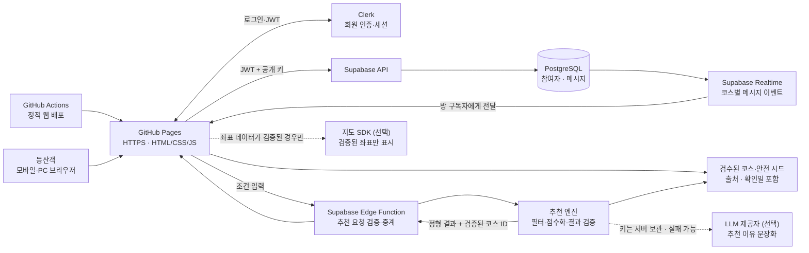
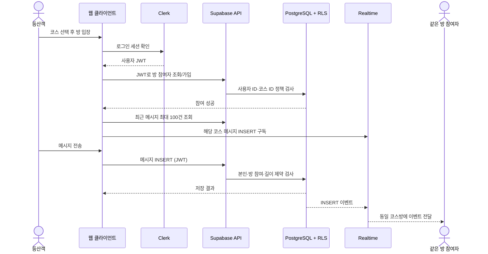
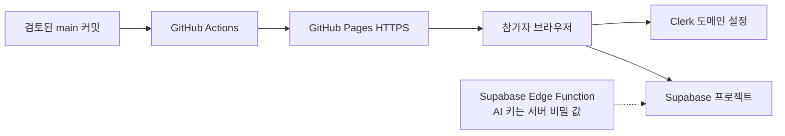

# TrailMate 경남 기술 설계서 (TRD)

> **문서 목적**: PRD에 정의된 문제와 사용자 흐름을 실제 해커톤 MVP로 구현하기 위한 기술 구조, 데이터 흐름, 보안 경계, 검증 기준을 정의한다.
> **문서 상태**: 심사 제출용 설계안. 구현 완료 여부는 아래 상태 표를 따르며, 설계 내용을 구현 사실로 간주하지 않는다.
> **기준 문서**: [PRD 및 요구사항 (이슈 #3)](https://github.com/seungbo7523/-NO.1/issues/3) · [프로토타입 (이슈 #2)](https://github.com/seungbo7523/-NO.1/issues/2)

## 1. 한눈에 보는 설계

TrailMate는 경남 2030 청년이 **코스 발견 → 크루 소통 → 현장 안전 확인**을 한 흐름으로 경험하는 모바일 우선 웹 서비스다. MVP는 관리 부담이 적은 정적 웹 프론트엔드와 관리형 인증·데이터·실시간 서비스를 사용한다. 추천은 검증된 코스 후보 안에서만 개인 조건에 맞게 순위를 매기며, AI는 안전 사실이나 코스를 만들어내지 않고 추천 이유를 설명한다.

| 구분 | 결정 |
| --- | --- |
| 주요 사용자 | 산행을 처음 시작하거나 코스 선택·동행·안전 부담 때문에 망설이는 경남 2030 청년 |
| 핵심 흐름 | 조건 입력 → 코스 추천·상세 → 코스 크루방 → 안전 정보·긴급 안내 |
| MVP 클라이언트 | 모바일 우선 정적 웹 (현재 `index.html`, JavaScript, Tailwind CSS) |
| 계정·실시간 채팅 | Clerk 인증 + Supabase PostgreSQL·Realtime·Row Level Security (RLS) |
| 추천 | 검증된 후보에 대한 결정론적 순위화 + 선택적 AI 설명, 실패 시 동일 후보의 규칙 기반 추천 |
| 안전 데이터 | 출처·확인일을 기록한 검수된 큐레이션 데이터. 확인하지 않은 위치·위험 정보는 사실처럼 표시하지 않음 |
| 배포 | GitHub Actions → GitHub Pages HTTPS |
| MVP에서 제공하지 않는 것 | 실제 구조 요청 전송, 검증되지 않은 실시간 사고 예측, 동의 없는 위치 공유, 검증되지 않은 AI 생성 코스 |

### 현재 구현과 설계 목표

| 기능 | 저장소에서 확인되는 상태 | 심사·시연 시 표현 |
| --- | --- | --- |
| 4단계 화면과 경남 코스 카드 | `index.html`에 시연용 코스와 화면 구현 | 코스 탐색 프로토타입 |
| 로그인 및 코스별 채팅 | Clerk·Supabase 클라이언트 코드와 SQL 스키마 존재 | 설정된 환경에서 동작 확인 후 실시간 채팅으로 소개 |
| 코스별 참여자 접근 제어 | Supabase RLS 정책 존재 | 서로 다른 계정·방으로 허용/차단 테스트 필요 |
| AI 추천 API | 아직 구현되지 않음 | 아래의 목표 설계. 실제 연동 전에는 AI가 동작한다고 설명하지 않음 |
| 실제 지도·GPS 위치 공유 | 현재 화면 요소는 시뮬레이션이며 위치 좌표 실시간 전송은 없음 | 시연용 화면이라고 표시 |
| 안전 시설·사고 데이터 연동 | 검증된 운영 데이터 연동 확인되지 않음 | 데이터 출처와 기준일 검증 전에는 샘플/시뮬레이션으로 표시 |
| GitHub Pages 배포 | 배포 워크플로 존재 | 심사 기기에서 공개 HTTPS 주소·로그인·채팅을 최종 확인 |

## 2. 시스템 아키텍처



### 신뢰 경계와 연결 규칙

1. 브라우저는 공개 웹 자산만 내려받는다. Clerk publishable key와 Supabase publishable/anon key는 공개 클라이언트 키이며, **Supabase service-role key나 LLM 비밀 키는 브라우저·Git 저장소에 넣지 않는다.**
2. Clerk 로그인 세션에서 발급한 JWT를 Supabase 요청에 전달한다. Supabase의 RLS가 요청 사용자와 방 참여 관계를 확인하며, 프론트엔드에서 숨긴 버튼만으로 접근을 통제하지 않는다.
3. AI 추천은 브라우저에서 모델 제공자를 직접 호출하지 않는다. 실제 모델을 연동할 경우 Edge Function이 입력을 검증하고 서버 측 비밀 키로 요청한다. 함수·모델 장애 시 결정론적 추천으로 전환한다.
4. 위치는 MVP에서 서버에 전송하지 않는다. 추후 기능을 추가할 때만 별도의 명시적 동의, 권한 확인, 저장 기간과 철회 처리를 포함한다.
5. 지도나 안전 시설 좌표가 검증되지 않으면 실제 위치 마커로 표현하지 않는다. 지도 SDK의 시각적 시연과 실제 위치 기반 안내를 구분한다.

## 3. 기술 구성 및 선정 이유

| 계층 | MVP 기술 | 선택 이유와 적용 범위 |
| --- | --- | --- |
| 웹 클라이언트 | 기존 정적 HTML·JavaScript·Tailwind CSS | 현재 동작하는 프로토타입을 재사용해 전환 비용을 줄이고 핵심 사용자 흐름 검증에 집중 |
| 정적 호스팅 | GitHub Pages + GitHub Actions | 별도 서버 운영 없이 HTTPS 배포. 비밀 값이 필요한 서버 기능은 여기서 실행하지 않음 |
| 사용자 인증 | Clerk (username/password) | 기존 로그인 구현 재사용. 게스트 입장은 요구사항과 현재 구현의 차이로 문서화 |
| 데이터베이스 | Supabase PostgreSQL | 코스방 참여자와 메시지를 저장하고 SQL 제약조건·RLS로 접근 제어 |
| 실시간 이벤트 | Supabase Realtime (Postgres Changes) | 메시지 INSERT를 같은 코스방 구독자에게 전달 |
| 추천 중계 | Supabase Edge Function (AI 연동 시) | 모델 비밀 키 보호, 입력 검증, 출력 스키마 검증, 요청 제한 |
| 코스·안전 데이터 | 버전 관리되는 검수 시드 데이터에서 시작 | 해커톤 중 외부 데이터 장애·키 설정 문제를 줄이고 출처와 기준일을 추적 |
| 지도 | 선택 기능: Kakao Maps 또는 Naver Maps | 지도 사업자·키·도메인 제한·좌표 데이터 검증 후 적용. 미확정 상태에서 실동작으로 표현하지 않음 |

**기술 선택 원칙**: 해커톤 MVP에서는 새로운 프레임워크로 전면 이전하지 않는다. 테스트 가능한 사용자 가치와 데이터 정확성을 우선한다. React/Next.js, 별도 코스 DB, 지도 API는 요구와 운영 조건이 확인될 때 증분 도입한다.

## 4. 주요 처리 흐름

### 4.1 조건 기반 코스 추천

1. 클라이언트가 난이도, 체력/컨디션, 희망 산행 시간 및 선택 입력을 제출한다. 이름, 계정 ID, 정밀 위치는 추천 입력에 포함하지 않는다.
2. 추천 엔진은 검수된 코스 목록에서 필수 조건에 맞지 않는 후보를 먼저 제외한다. 초급자에게 검증되지 않은 고난도 코스를 추천하는 등 안전 필터를 점수로 상쇄할 수 없게 한다.
3. 남은 후보의 설명 가능한 점수를 계산한다. 시작 가중치는 팀이 코스 데이터와 비팀원 테스트로 조정한다.

   `점수 = 0.40 × 난이도 적합도 + 0.30 × 희망 시간 적합도 + 0.20 × 컨디션 적합도 + 0.10 × 검증된 당일 조건 적합도`

   당일 기상 등 신뢰 가능한 최신 입력이 없으면 해당 항목은 “미반영”으로 표시하고 사용 가능한 가중치만 재정규화한다. 존재하지 않는 날씨·사고 데이터를 추정해 넣지 않는다.
4. AI 기능을 활성화한 경우에도 추천 엔진이 정한 코스 ID와 사실만 모델에 제공한다. 모델은 후보를 새로 만들거나 안전 등급을 변경할 수 없고, 설명 문장만 생성한다. JSON 스키마·코스 ID·문장 길이를 검증하며, 검증 실패·타임아웃·한도 초과 시 규칙 기반 설명으로 대체한다.
5. 화면은 추천 이유와 코스의 거리·예상 시간·고도, 데이터의 출처·확인일을 함께 표시한다. 후보가 없으면 결과 없음과 필터 조정 방법을 안내한다.

**AI 정직성 원칙**: 현재 저장소에 AI 모델/API 연동은 없다. Edge Function과 모델을 실제 연결하고 성공·장애 대체 경로를 확인하기 전까지 기능을 “AI 연동 완료”로 소개하지 않는다. MVP에서 AI 연동이 불가하면 설명 가능한 규칙 기반 추천을 제공하고 AI 기능은 후속 범위로 표기한다.

### 4.2 크루방 입장과 실시간 메시지



- 방 입장 후 최대 최근 100건을 조회하고, 해당 `course_id`의 새 메시지만 실시간 구독한다.
- 메시지는 서버 저장 성공 응답 후 화면에 반영한다. 실패한 메시지를 전송 완료처럼 표시하지 않고 재시도 가능한 오류를 보여준다.
- “정상 도착·휴식 중·택시 동행”은 현재 구현에서 채팅 메시지형 빠른 상태다. 별도 고정 상태 배지로 표현하려면 데이터 모델·만료·해제 정책을 먼저 확정한다.
- 나가기 또는 사용자 변경 시 이전 Realtime 채널을 해제하고 해당 방 화면을 비운다.

### 4.3 안전 정보와 긴급 안내

- 코스 안전 항목은 유형(위험 구간, 쉼터, 화장실, 구급함), 출처, 확인일 및 검증된 좌표가 있을 때만 표시한다.
- 권한 거부, GPS 미수신 또는 데이터 미등록은 각각 별도 상태로 안내한다. 정보 부재를 “위험 없음” 또는 “시설 없음”으로 해석하지 않는다.
- 119 버튼은 지원 기기에서 전화 앱을 여는 `tel:119` 링크다. 서비스가 신고를 전달하거나 구조를 요청했다고 주장하지 않는다.
- 국가지점번호는 검증된 데이터/변환 절차가 확보될 때만 실제 값으로 제시한다. 그 전에는 현장 표지판 확인과 119 직접 통화를 안내한다.
- 안내 문구에는 정보의 기준일과 “현장 표지판·공식 안내를 우선 확인”하는 주의 문구를 제공한다. 앱은 구조·의료 전문 판단을 대신하지 않는다.

## 5. 데이터 설계

### 5.1 현재 Supabase 테이블

`supabase/schema.sql` 및 `supabase/clerk-migration.sql`에 정의된 스키마를 기준으로 한다.

| 테이블 | 핵심 컬럼 | 제약·용도 |
| --- | --- | --- |
| `course_room_members` | `course_id`, `user_id`, `display_name`, `joined_at` | `(course_id, user_id)` 기본 키. 사용자별 코스방 참여 |
| `course_room_messages` | `id`, `course_id`, `user_id`, `display_name`, `body`, `created_at` | 메시지 저장. `(course_id, created_at)` 조회 인덱스, Realtime publication 등록 |

- Clerk 연동 후 사용자 식별자는 Clerk JWT의 `sub`와 일치하는 text 값이다. 신규/기존 프로젝트 SQL 적용 순서는 README 설정 절차를 따른다.
- 현재 허용 코스 ID는 DB 제약조건에 고정(`cheonjusan`, `muhaksan`, `hwangmaesan`, `yongji`)되어 있다. 새 코스 추가 시 프론트엔드 데이터와 SQL 제약조건을 함께 변경한다.
- 메시지 본문은 공백 제거 후 1~1,000자, 표시 이름은 1~30자 범위로 클라이언트와 DB 모두에서 제한한다.

### 5.2 코스·안전 데이터 계약

시드 데이터를 파일로 관리할 때도 동일한 필드 계약을 적용한다. 좌표는 현장·공공 출처를 검증한 항목에만 포함한다.

```json
{
  "id": "cheonjusan",
  "name": "창원 천주산 진달래길 코스",
  "region": "경남 창원시",
  "difficulty": "beginner",
  "distanceKm": 4.2,
  "estimatedMinutes": 100,
  "summitElevationM": 638,
  "conditionTags": ["light_hike"],
  "elevationProfile": [],
  "source": "검증 후 실제 출처 기재",
  "verifiedAt": "검증 후 날짜 기재"
}
```

| 안전 항목 필드 | 규칙 |
| --- | --- |
| `id`, `courseId`, `type`, `name` | 식별자와 코스, 유형(`hazard`, `shelter`, `toilet`, `first_aid`)을 명시 |
| `latitude`, `longitude` | 좌표 출처·정확도 확인이 끝난 경우에만 저장·표시 |
| `source`, `verifiedAt` | 출처와 확인일이 없는 데이터는 실제 안전 정보로 노출하지 않음 |
| `status` | `verified`, `sample`, `unavailable`을 구분해 샘플을 운영 데이터와 혼동하지 않음 |

## 6. 인증, 보안 및 개인정보

### 6.1 Supabase RLS 정책

| 동작 | 필수 정책 |
| --- | --- |
| 참여자 조회 | 로그인 사용자는 본인의 참여 정보만 조회 |
| 방 참여 | JWT `sub`와 요청 `user_id`가 일치할 때만 가입 |
| 방 나가기 | 로그인 사용자는 본인의 참여 정보만 삭제 |
| 메시지 조회 | 요청 사용자가 동일 `course_id`의 참여자인 경우에만 허용 |
| 메시지 작성 | 작성자 ID가 JWT `sub`와 같고 해당 방 참여자인 경우에만 허용 |
| 실시간 구독 | 데이터베이스 RLS를 동일하게 적용. 클라이언트의 코스 필터만 보안 경계로 신뢰하지 않음 |

### 6.2 데이터 보호 원칙

- GPS 공유를 구현할 때 기본값은 OFF다. 명시적 동의와 위치 권한 허용 후에만 공유하고, 화면에 공유 중임을 지속 표시한다.
- 동의 철회·방 나가기·로그아웃 시 위치 전송을 즉시 중단한다. 저장 위치의 삭제/만료와 모든 참여자 화면에서의 제거를 함께 검증한다.
- P0 채팅·인증에서 필요하지 않은 전화번호, 실명, 정밀 위치를 수집하지 않는다. 추천 요청은 익명 조건값만 전달한다.
- Clerk 사용자 표시 이름은 사용자 프로필 데이터이지 실명 인증값이 아니다. 채팅 입력은 HTML로 실행하지 않고 텍스트로 렌더링한다.
- 클라이언트 키는 공개 키로만 제한하고 DB 권한은 RLS로 집행한다. 비밀 키·비밀번호·세션 토큰을 코드, 커밋, 화면 오류에 포함하지 않는다.
- 채팅 및 위치의 보관·탈퇴·삭제 기간은 실제 공개 전에 운영자가 정하고 안내한다. 정책을 결정하지 않은 위치 기록은 저장하지 않는다.

## 7. 비기능 요구사항과 장애 처리

| 항목 | 목표·처리 |
| --- | --- |
| 반응형 UX | 모바일 우선. 코스 선택부터 안전 안내까지 핵심 동작을 작은 화면에서 스크롤·키보드 조작으로 수행 가능 |
| 실시간성 | 다중 접속 테스트에서 채팅/빠른 상태의 95% 이상을 2초 이내 반영하는 것을 목표로 측정 |
| 추천 응답 | 추천 API를 연동할 경우 정상 응답 p95 3초 이내 목표. 타임아웃이면 결정론적 로컬 점수 결과를 제공 |
| 접근성 | 버튼 이름, 입력 오류, 연결/전송 상태를 텍스트와 접근 가능한 상태 요소로 제공. 색상만으로 위험·성공을 구분하지 않음 |
| 데이터 신뢰 | 모든 코스·시설 데이터에 출처와 기준일을 기록. 출처 또는 좌표를 확인하지 못하면 미확인으로 표시 |
| 서비스 장애 | Clerk·Supabase·모델 장애를 구별해 알림. 채팅 실패 시 전송 실패 표시, 모델 장애 시 규칙 기반 추천, 지도 장애 시 안전 정보 목록/전화 안내 제공 |
| 네트워크 불안정 | 저장·동기화 성공을 가장하지 않음. 현재 연결 여부와 마지막으로 확인된 데이터 시각을 표시 |
| 배포 | HTTPS와 Clerk 허용 도메인 설정 확인. `main` 배포 후 별도 기기/네트워크에서 실제 공개 접속 검증 |

**안전 기능의 장애 원칙**: 지도나 GPS가 작동하지 않더라도 안내 문구는 사용할 수 있어야 한다. 단, 이 기능을 오프라인 안전 서비스라고 부르려면 검증된 오프라인 데이터 저장·만료·복원 기능을 별도로 구현하고 시험해야 한다.

## 8. 배포 및 운영



1. 변경은 PR에서 검토한 뒤 `main`에 반영한다.
2. GitHub Actions가 정적 웹 자산을 GitHub Pages에 배포한다. 저장소에 커밋한 모든 정적 파일은 공개될 수 있으므로 비밀 설정 파일을 포함하지 않는다.
3. Clerk의 허용 도메인/redirect URL, Supabase URL·공개 키, Clerk-Supabase JWT 연동, RLS 및 Realtime publication을 대상 환경에서 확인한다.
4. AI 모델을 활성화하는 경우 Supabase Edge Function에 제공자 키를 비밀 값으로 설정한다. 프론트엔드 번들·GitHub Actions 로그·응답에 키가 노출되지 않는지 확인한다.
5. 릴리스 전 HTTPS 접근, 코스 선택, 새 계정 로그인, 두 사용자 간 메시지, 다른 방 차단 및 안전 안내를 실제 모바일 브라우저에서 점검한다.

## 9. 검증 계획과 완료 기준

PRD에서 제시한 목표를 **측정 가능한 인수 기준**으로 사용한다. 결과를 측정하기 전에는 달성했다고 주장하지 않는다.

| 검증 영역 | 절차 | 통과 기준 |
| --- | --- | --- |
| 추천·입장 사용성 | 비팀원 5명 이상이 조건 선택 → 추천 확인 → 코스 상세 → 크루방 진입 수행 | 성공 완료율 85% 이상. 인원, 성공 건수, 환경을 함께 기록 |
| 추천 안전성 | 허용되지 않은 난이도 후보, 후보 데이터 누락, 기상 데이터 없음, 모델 장애/잘못된 JSON을 주입 | 부적합 후보 미노출. 출처 없는 사실 생성 없음. 모델 장애 시 규칙 결과 제공 |
| 실시간 채팅 | 두 계정·두 기기에서 같은 방과 서로 다른 방을 각각 시험. 각 기기 전송 시각·수신 시각 기록 | 같은 방 이벤트 95% 이상이 2초 이내 수신. 다른 방 메시지 읽기/구독 불가 |
| 메시지 검증 | 비인증, 비참여자, 빈 문자열, 1,000자 초과, HTML 입력으로 요청 | 서버 RLS/제약이 거부하거나 안전한 텍스트로 렌더링 |
| 안전 안내 | 안전 정보 있는/없는 코스, 위치 권한 거부, GPS 미수신, 통신 끊김 시험 | 안전 화면에서 위험/거점 및 119·국가지점번호 안내 확인 평균 15초 이내. 미확인 자료를 실제 정보로 표시하지 않음 |
| 위치 개인정보 | 동의 OFF, 권한 거부, 동의 ON 후 철회, 방 퇴장 시험 | 동의 전 좌표 전송 0건. 철회 이후 업데이트 0건. P1 구현 전에는 위치 서버 요청 0건 |
| 배포·시연 | 공개 HTTPS 주소를 팀 외부 기기·네트워크에서 접속 | 4단계 시연 성공. 핵심 흐름에서 치명적 오류 0건 목표 |

테스트 기록에는 빌드/커밋, 날짜, 브라우저·기기, 네트워크, 시도 건수, 원시 성공/실패 건수, 지연 측정값 및 미해결 문제를 남긴다. 평균이나 퍼센트만으로 표본 수를 숨기지 않는다.

## 10. 범위, 단계 및 위험 관리

### 해커톤 단계

| 단계 | 결과물 | 완료 조건 |
| --- | --- | --- |
| 1. 기반 | 기존 정적 UI, 코스 시드, 배포 주소, Clerk·Supabase 설정 | 공개 HTTPS에서 인증과 코스 탐색 확인 |
| 2. 연결 | 코스방 참여, 채팅 저장·Realtime, RLS | 서로 다른 계정으로 동일 방 동기화 및 타 방 차단 검증 |
| 3. 신뢰성 | 추천 규칙·설명, 안전 출처/확인일, 오류·정보 부재 UX | AI/네트워크 장애 대체 경로와 허위 정보 방지 확인 |
| 4. 심사 리허설 | 모바일 실기기 시나리오, 측정 결과, 시연 제한사항 | 9절 기록 완료, 미구현 기능을 명확히 표시 |
| P1 (시간 여유 시) | 명시적 동의 기반 실시간 위치, 검증된 지도 레이어, 오프라인 캐시 | 개인정보·철회·오래된 데이터 테스트를 통과해야 공개 |

### 주요 위험과 대응

| 위험 | 영향 | 대응 |
| --- | --- | --- |
| 프로토타입 시뮬레이션을 실제 GPS/안전 기능으로 오인 | 현장 안전과 심사 신뢰에 큰 위험 | 화면의 샘플/시뮬레이션 표시, 검증된 좌표만 사용, 미구현 기능을 시연 전 명시 |
| LLM이 코스·위험 사실을 지어냄 | 잘못된 산행 판단 | 검색 후보 ID만 전달, 구조화 결과 검증, 모델을 안전 판정에 사용하지 않음, 실패 시 규칙 기반 대체 |
| Supabase 설정/RLS/JWT 오류 | 로그인·채팅 실패 또는 데이터 노출 | SQL 적용 순서 재현, 비인증·타방 접근 테스트, 운영 키 미사용 |
| 지도/API 키·통신 장애 | 지도가 안 보이거나 안내 누락 | API에 의존하지 않는 안전 목록과 119 안내 유지, 키·도메인 사전 확인 |
| 오래되거나 출처 불명인 안전 데이터 | 부정확한 현장 정보 | 출처·확인일 필수, 오래된 자료 경고, 최신 여부 모를 때 실시간 표현 금지 |
| 실시간 채팅 동시접속·지연 | 시연 흐름 중단 | 두 기기 사전 리허설, 연결 상태 표시, 오류 재시도, 검증된 시연 계정 준비 |

### 범위 밖

- 실제 119 신고 중계, 구조 출동 보장, 응급 의료 판단
- 검증되지 않은 사고 예측·위험 점수와 위치 자동 추론
- 이번 MVP에서 위치 기반 추적을 기본 활성화하거나 채팅 위치를 무기한 저장하는 것
- 장비 거래·결제, 대회 예약, 정식 커뮤니티 운영
- 학습 데이터가 없는 상태에서 정확도를 주장하는 모델 학습·개인화

## 11. 심사에서 주장할 수 있는 기술적 가치

- **지역 맞춤성**: 경남 코스 후보와 이용 조건을 데이터화해 일반적인 전국 코스 목록이 아닌 지역 청년의 진입 장벽을 다룬다.
- **연속적인 UX**: 추천 결과가 코스 상세, 동일 코스 크루방, 안전 확인으로 이어지도록 한 제품 흐름을 갖는다.
- **설명 가능한 추천**: 적합도 입력과 점수를 공개하고 검증된 후보만 추천한다. 데이터가 부족하면 AI가 사실을 보충하지 않고 제한사항을 드러낸다.
- **프라이버시 우선**: 위치 공유를 기본 기능으로 가장하지 않으며, 향후 구현은 명시적 동의·철회·만료를 완료 기준으로 둔다.
- **실현 가능성과 검증성**: 기존 정적 웹·Clerk·Supabase 기반을 재사용하고, 실시간성·사용성·권한 격리를 수치와 재현 절차로 평가한다.
- **안전 책임성**: 앱이 구조 신고를 완료했다고 오인시키지 않고, 신뢰 가능한 데이터가 없을 때 119 직접 통화와 현장 표지 확인을 안내한다.

## 12. 심사 제출 전 체크리스트

- [ ] AI 추천 API 또는 AI를 사용하지 않는 대체 경로를 실제로 시연하고 표현을 일치시켰는가?
- [ ] 코스·안전 정보의 출처, 확인일, 데이터 소유/검증 담당을 채웠는가?
- [ ] 두 사용자 기기에서 실시간 채팅과 타 방 접근 차단을 확인했는가?
- [ ] 위치·고도·통신 상태의 시뮬레이션과 실제 기능을 화면에서 구별했는가?
- [ ] GitHub Pages 공개 주소, 로그인 허용 도메인, HTTPS와 재접속을 확인했는가?
- [ ] 9절의 실제 측정 결과와 테스트 표본 수를 문서/발표에 첨부했는가?
- [ ] 미구현 기능과 실패 시 안전 안내를 발표에서 과장 없이 설명할 수 있는가?
